

# Pneumonia Detection from Chest X-rays
### Explainable, calibrated and uncertainty-aware deep learning: CNN from scratch vs. ResNet-18 transfer learning

   

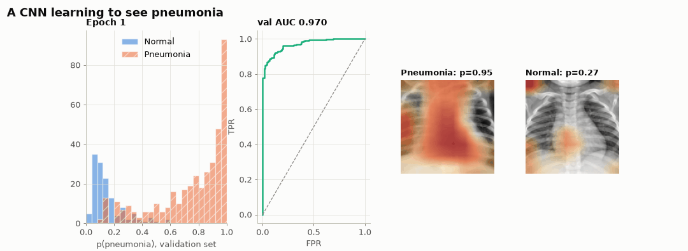

> **© 2026 Husain Naqvi. All rights reserved.** This is a portfolio showcase. Copying, re-uploading or reusing any part of this work without written permission is prohibited — see [LICENSE](LICENSE).

> **⚠️ Research and education only.** This is not a medical device and must never be used to diagnose anyone.

Two networks learn to detect pneumonia in **5,856 paediatric chest X-rays** (PneumoniaMNIST, 128 × 128). Accuracy is only the
start. The project asks four questions a clinician would ask:

1. **Where does the model look?** Grad-CAM, integrated gradients (with a numerical check of the completeness axiom) and occlusion.
2. **Can its probabilities be trusted?** Reliability diagrams, expected calibration error and temperature scaling.
3. **Does it know when it is unsure?** Monte-Carlo dropout, split into aleatoric and epistemic uncertainty, and selective prediction.
4. **Which threshold should be used?** Sensitivity/specificity trade-offs, Youden's J and decision-curve net benefit.

Every comparison uses **paired statistics** (stratified bootstrap CIs, paired bootstrap ΔAUC and McNemar's exact test) over **3 independent training runs** per model.

## Results

Held-out test set: 624 X-rays (62.5% pneumonia). Mean ± s.d. over 3 seeds at τ = 0.5.

| Model | AUC | Accuracy | Sensitivity | Specificity | F1 | ECE → after *T* | Params |
|---|---|---|---|---|---|---|---|
| **ResNet-18** | 0.991 ± 0.001 | 0.959 ± 0.006 | 0.976 ± 0.017 | 0.930 ± 0.016 | 0.967 ± 0.005 | 0.029 → 0.048 | 11.18 M |
| **CNN** | 0.982 ± 0.005 | 0.942 ± 0.007 | 0.958 ± 0.007 | 0.916 ± 0.009 | 0.954 ± 0.006 | 0.019 → 0.023 | 0.29 M |

- **ΔAUC (ResNet − CNN)** = +0.005, 95% paired-bootstrap CI [+0.001, +0.010] · **McNemar** b = 14, c = 10, exact p = 0.54
- **Transfer learning wins, but only by a little.** The paired ΔAUC CI excludes zero, but at τ = 0.5 McNemar's test finds no significant difference in errors.
- **A 38× smaller model comes close.** The 294 k-parameter CNN is within 0.01 AUC of ResNet-18, but its AUC varies 8× more across seeds.
- **Calibration does not survive a prevalence shift.** Temperature scaling, fitted on validation data (74% pneumonia), *raises* test ECE (62.5% pneumonia): ResNet-18 goes from 0.029 to 0.048. Calibration is specific to the case mix it was fitted on.
- **Uncertainty flags errors.** MC-dropout entropy is 0.60 bits on errors versus 0.10 bits on correct predictions, giving error-detection AUROC 0.91 and supporting selective prediction.
- **The threshold is a clinical choice.** Youden's validation threshold gives 99.2% sensitivity and 85.9% specificity on test. Decision curves beat "treat all" over the whole threshold range.
- **Saliency maps expose shortcuts.** On errors, the maps often sit on the heart and mediastinum rather than the lung fields.

## Visual tour

| | |
|---|---|
| 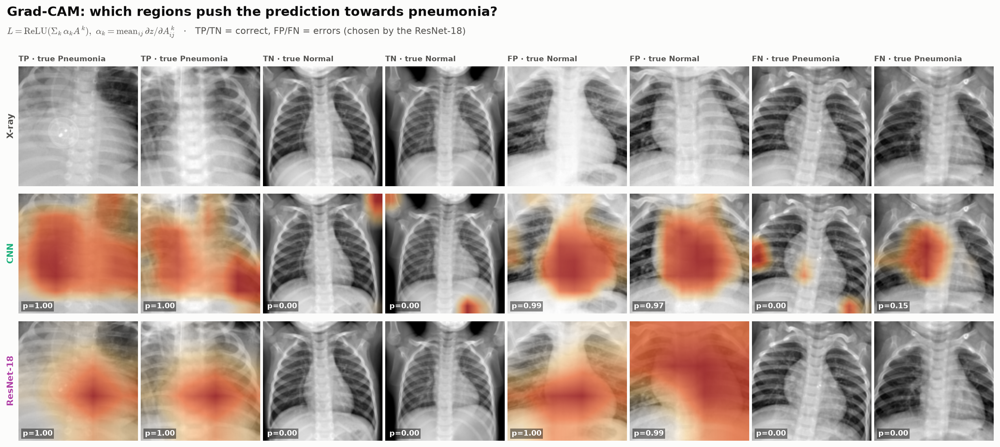 **Grad-CAM** on correct and incorrect cases | 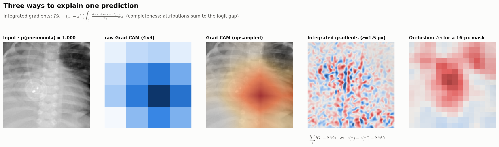 **Grad-CAM vs. integrated gradients vs. occlusion** |
| 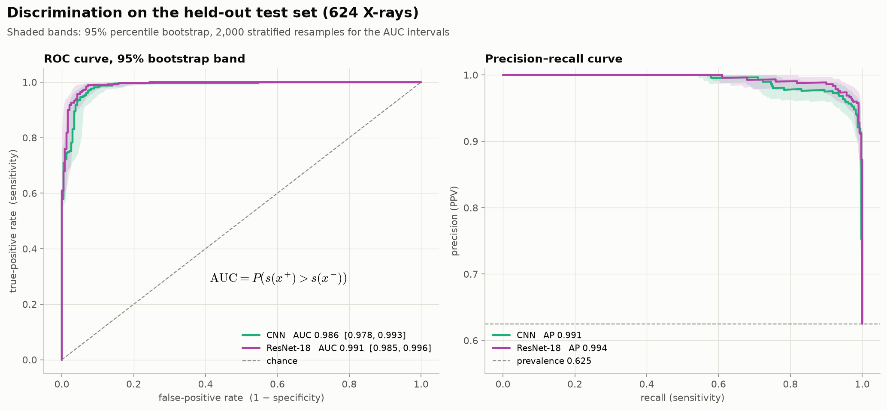 **ROC & PR** with 95% bootstrap bands | 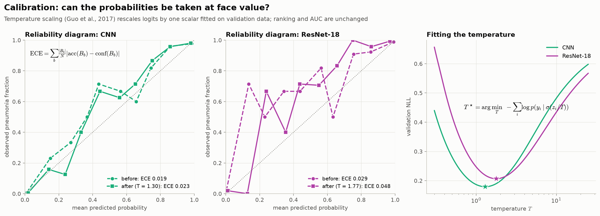 **Calibration** and temperature scaling |
| 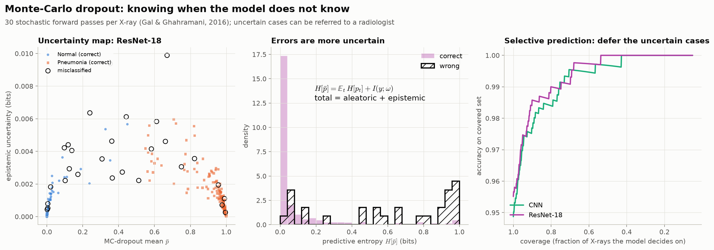 **MC-dropout uncertainty** and selective prediction | 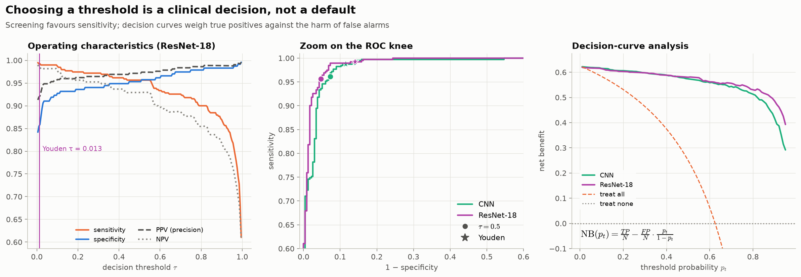 **Thresholds** and decision curves |
| 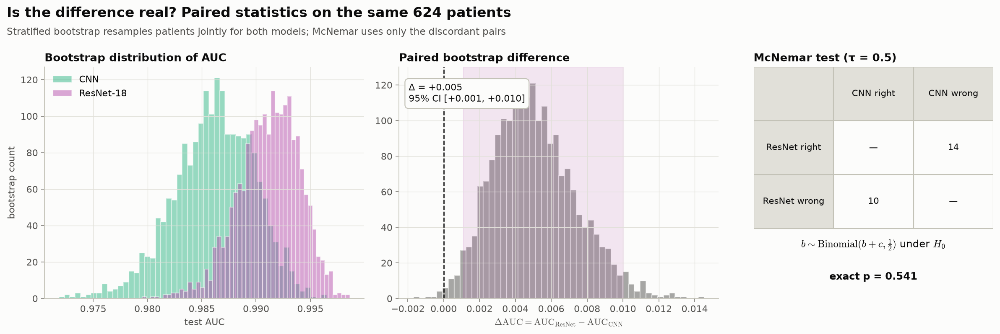 **Paired statistics** | 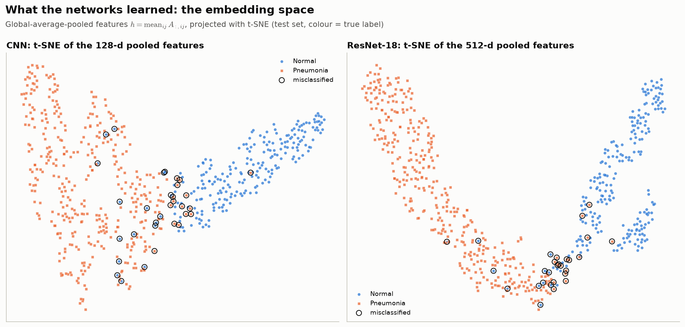 **t-SNE embeddings** |
| 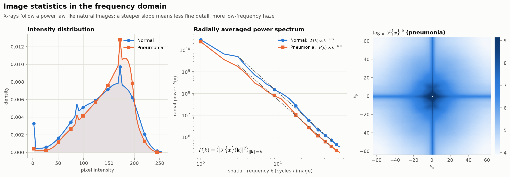 **Fourier power spectra** | 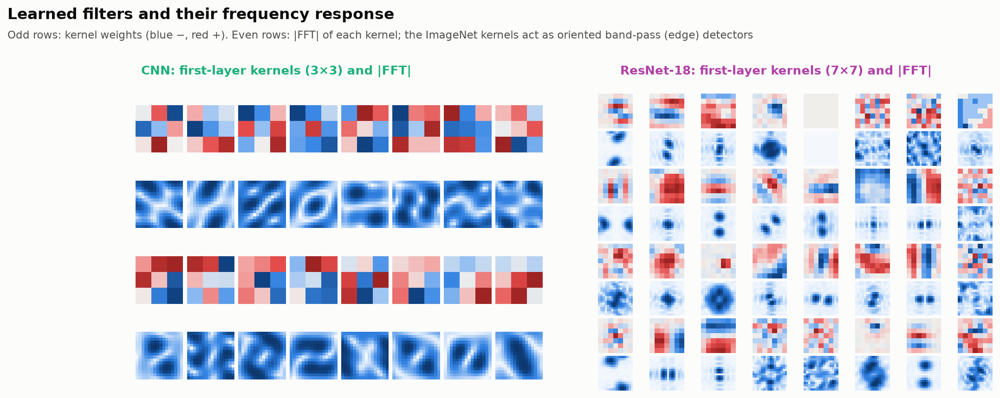 **First-layer filters & their FFT** |
| 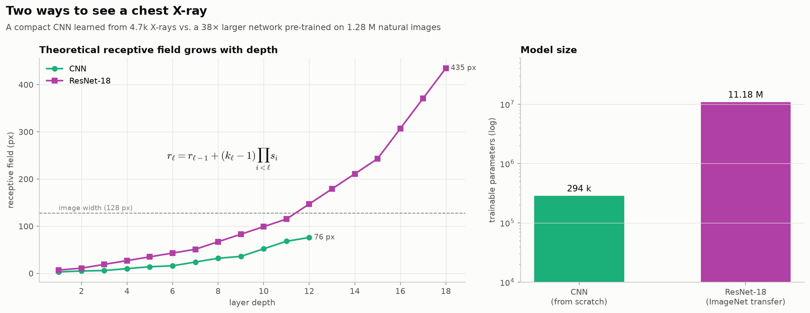 **Receptive fields** | 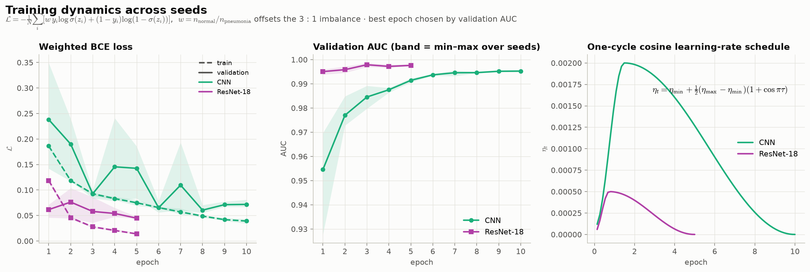 **Training dynamics** |

Interactive versions: [threshold explorer](https://engr-husainnaqvi.github.io/Pneumonia-Xray-AI/interactive/threshold_explorer.html) ·
[Grad-CAM browser](https://engr-husainnaqvi.github.io/Pneumonia-Xray-AI/interactive/gradcam_browser.html) ·
[3-D embedding](https://engr-husainnaqvi.github.io/Pneumonia-Xray-AI/interactive/embedding_3d.html)

## The mathematics

**Model and loss.** Both networks end in global average pooling and one logit, $p(\text{pneumonia}\mid x)=\sigma(z)$. Training uses
class-weighted binary cross-entropy (74 % of training images are pneumonia):

$$\mathcal L=-\frac1N\sum_i\Big[w\,y_i\log\sigma(z_i)+(1-y_i)\log\big(1-\sigma(z_i)\big)\Big],\qquad w=\frac{n_\text{normal}}{n_\text{pneumonia}}$$

**Grad-CAM** (Selvaraju et al., 2017): $\alpha_k=\frac1{hw}\sum_{ij}\partial z/\partial A^k_{ij}$, $\;L=\mathrm{ReLU}\big(\sum_k\alpha_kA^k\big)$.

**Integrated gradients** (Sundararajan et al., 2017), with the completeness axiom verified in the tests:

$$\mathrm{IG}_i(x)=(x_i-x'_i)\int_0^1\frac{\partial z\big(x'+\alpha(x-x')\big)}{\partial x_i}d\alpha,\qquad\sum_i\mathrm{IG}_i=z(x)-z(x')$$

**MC dropout** (Gal & Ghahramani, 2016): $H[\bar p]=\tfrac1T\sum_tH[p_t]+I(y;\omega)$, i.e. total = aleatoric + epistemic.

**Temperature scaling** (Guo et al., 2017): $T^\star=\arg\min_T\,\mathrm{NLL}\big(\sigma(z/T)\big)$ on validation data;
$\mathrm{ECE}=\sum_b\frac{|B_b|}{N}\left|\mathrm{acc}(B_b)-\mathrm{conf}(B_b)\right|$.

**Decision curves** (Vickers & Elkin, 2006): $\mathrm{NB}(p_t)=\frac{TP}{N}-\frac{FP}{N}\cdot\frac{p_t}{1-p_t}$.

**Receptive field**: $r_\ell=r_{\ell-1}+(k_\ell-1)\prod_{i<\ell}s_i$. **Power spectrum**: $P(k)=\langle|\mathcal F\{x\}(\mathbf k)|^2\rangle_{\lVert\mathbf k\rVert=k}\propto k^{-\beta}$.

## Source code and trained models

The full implementation (source package, experiment and figure scripts, unit tests, the
walkthrough notebook and the trained model weights) is kept in a **private repository**.
Access is available on request to professors, admissions committees, reviewers and
collaborators — contact me via [LinkedIn](https://www.linkedin.com/in/hafizhussain) or [GitHub](https://github.com/Engr-HusainNaqvi).

Everything you need to evaluate the work is public here: the results, every figure, the
[project page](https://engr-husainnaqvi.github.io/Pneumonia-Xray-AI/), the interactive pages and the live demo.

## Limitations

- Paediatric patients (ages 1–5) from a single centre: results will not transfer to adults or other hospitals and scanners without validation.
- 128 × 128 px discards detail a radiologist would use.
- Saliency maps show what the model used, not what is clinically correct, and can reveal shortcuts (text markers, positioning).
- MC dropout is an approximation to Bayesian uncertainty, not a guarantee.

## References

1. Kermany et al. (2018). Identifying medical diagnoses and treatable diseases by image-based deep learning. *Cell* 172(5).
2. Yang et al. (2023). MedMNIST v2. *Scientific Data* 10.
3. He et al. (2016). Deep residual learning for image recognition. *CVPR*.
4. Selvaraju et al. (2017). Grad-CAM. *ICCV*.
5. Sundararajan, Taly & Yan (2017). Axiomatic attribution for deep networks. *ICML*.
6. Gal & Ghahramani (2016). Dropout as a Bayesian approximation. *ICML*.
7. Guo et al. (2017). On calibration of modern neural networks. *ICML*.
8. Vickers & Elkin (2006). Decision curve analysis. *Medical Decision Making* 26(6).
9. Rajpurkar et al. (2017). CheXNet. *arXiv:1711.05225*.

## Data and licence

Data: [PneumoniaMNIST](https://medmnist.com/) (CC BY 4.0), derived from Kermany et al. (2018). Code, models, figures and text: © 2026 Husain Naqvi, all rights reserved (see [LICENSE](LICENSE)). To cite this work, use `CITATION.cff`.

**Author:** Husain Naqvi, Biomedical Engineer · [GitHub](https://github.com/Engr-HusainNaqvi) · [LinkedIn](https://www.linkedin.com/in/hafizhussain)
